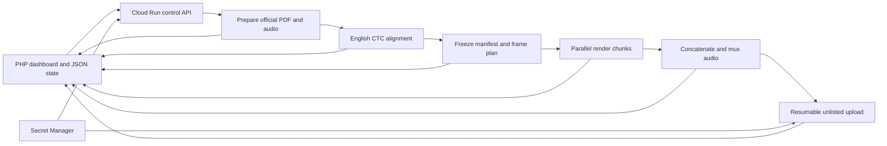

# Cloud video pipeline

This directory contains cloud workflow additions to the existing video project.
[REQUIREMENTS.md](REQUIREMENTS.md) records the owner's accepted output contract:
use the existing `index.html`, `script.js`, fonts/assets, preprocessing and YouTube
formatters. Change workflow scheduling, alignment and parallel capture while
preserving that presentation and publication behavior.

The production capture driver is `render/original.js`. It runs the copied,
checksum-verified original `presentation/renderer/index.html` and `presentation/renderer/script.js` with the
original assets and fonts. Each chunk replays the original state changes before
capturing its range. The earlier `render/player.*` and `chunk.js` files are
unused prototypes. The root interactive player is separate from video capture.

The dashboard is deployed at **https://scotusstats.com/youtube/**. The first
passkey is registered; source redeployment preserves its credential file. Private
JSON files live on the webhost outside the scotusstats public directory. The
small Cloud Run control service handles job launch, guided login and credential
replacement.
CPU workers and the authenticated ten-minute timer are deployed. Automatic work is enabled as of October 14, 2026. Each queued recording has a
**Start** button: it runs that recording through its remaining stages, reviews
and bounded repairs while automatic work stays paused. **Resume automatic work**
also enables current-term discovery/backfill. Videos finish unlisted and require
a dashboard publication action. **Cancel** revokes a recording's start request;
an owner-requested **Retry** starts its incomplete work again.
Photo review holds the video plan but allows prepared audio/transcripts to align.
New portraits are attached to a multimodal Codex crop task. Its bounded square
coordinates are applied with Pillow; original files, crop metadata and source
previews are retained. **Show full image** reveals the original proportions.
Each review offers **Find different image**, **Recrop**, and **Switch to synthetic
picture**, with an optional owner hint. A dedicated `scotus-video-photos` worker
processes these durable requests alongside alignment. Replacements need fresh
approval. Synthetic alternatives use deterministic initials or verified logos.
Photo research explicitly permits LinkedIn profile photos and news portraits,
with docket/employer/location identity checks. The policy is supplied inline;
photo prompts do not require a separate `POLICY.md`. Web search does not inherit
the owner's local Chrome login. When search cannot expose a portrait, photo tasks
can call `photo_fetch_authenticated` for a LinkedIn profile. A host-mediated GET
reads owner cookies from Secret Manager; only the photo/enrichment account has
access. It permits `/in/` profiles, follows no redirects and returns selected
profile metadata/portrait URLs rather than raw HTML, cookies or account content.
Each task has at most four bounded fetches. Session cookies stay outside model
prompts, image URLs and diagnostics. Renew them with `infra/deploy_photo_access.py`
using a private JSON bundle; rejected/expired sessions become private notes.
Pipeline and repair workers use the same source baseline. The year-alignment
repair is incorporated into that source; incomplete Oyez court rosters use the
existing justice catalog. The backend automatically queues vision crops for legacy
uncropped candidates as well as locally imported photographs.

## Persistence of repairs

A code repair is a small, stage-scoped JSON release in the private media bucket,
containing replacement files and a hash of the exact worker source baseline.
Isolated tests produce a separate report. The controller records the selected
release and explanatory history in the webhost's private `state.json`; a new
Cloud Run execution verifies its hashes and applies it before importing the
worker. Completed transcripts, alignment and other artifacts remain reusable.

Codex can mark a tested fix as input-independent and explain why. It becomes a
default for later cases only after the repaired phase finishes successfully with
its normal checks. Defaults are indexed by stage and source baseline, so an image
upgrade cannot silently apply an old patch. Later repairs start with the active
release already applied, preserving earlier fixes to the same file.

This does not automatically commit workflow code to GitHub or rebuild the default
image. Source promotion incorporates a validated fix into this repository and a
new worker image. Approved advocate-image commits use a separate GitHub publisher.
Notifications remain enabled; their redundant dashboard setup section is removed.

`scotus_cloud/presentation_data.py` contains the recording-aware case and audio data
adapters and is editable by planning recovery. `court_metadata.py` handles incomplete
Oyez fields. `formatters.py` retains the protected public formatters;
`presentation_sources.py` loads checksum-verified renderer and formatter sources. Missing or unusable Argued dates use the recording's known date; valid
Granted, Argued and Decided events remain intact.

Each phase launch records its Cloud Run operation. The timer checks operation
completion independently of worker heartbeats, catching containers that exit
before claiming a lease. Closed executions with missing results become failures
with a private recovery log and generic phone alert; completed chunks are retained.
Initial claim network timeouts get bounded retries with one claim identity, so a
lost response cannot abandon an already granted lease. Dashboard phase details
show completed, running, waiting and failed chunk counts.

Production trusts successful FFmpeg execution: chunk and final-output checks read
MP4 headers, without decoding frames or recounting packets. Stream parameters are
saved in chunk receipts and reused at assembly. Media checksums are calculated
while downloading, rather than rereading the files. Browser operations share one
readiness call and cache decoded images by source; the original HTML/JS/assets and
frame timings remain unchanged. Worker replies launch a fixed background PHP
dispatcher instead of waiting on nested cloud callbacks. Safe reads and idempotent
credential/recovery claims have bounded transport retries.

## Components



| Part | Responsibility |
| --- | --- |
| `dashboard/public/` | Sober HTML/CSS/JavaScript interface, passkey API and protected JSON route. |
| `dashboard/private/state.php` | JSON transactions, role-scoped worker updates, leases, progress, commands and recovery. |
| `scotus_cloud/control.py` | HMAC-authenticated Cloud Run API for dispatch and credential replacement. |
| `scotus_cloud/prepare.py` | Native PDF extraction, printed paragraphs and appearances-based speaker resolution. |
| `scotus_cloud/alignment.py` | English Wav2Vec2 greedy coarse anchors followed by bounded CTC fine alignment. |
| `scotus_cloud/model.py` | Immutable manifests and exact, contiguous 20 fps frame ranges. |
| `render/` | Original JavaScript state replay, capture and parallel chunk encoding. |
| `scotus_cloud/worker.py` | Cloud-only stage entry point, heartbeats, cloud object transfer and assembly. |
| `scotus_cloud/connections.py` | Guided provider exchanges, Google web-client validation and repository-scoped GitHub App tokens. |
| `scotus_cloud/codex_login.py` | Private device-code sign-in through the native Codex app-server; no inference. |
| `scotus_cloud/github_assets.py` | Atomic new-portrait and provenance commits with existing-file protection. |
| `scotus_cloud/youtube.py` | Durable resumable sessions, saved video IDs and refreshed Google credentials. |
| `scotus_cloud/codex_auth.py` | Serialized credential round-trip and private input staging for a single-turn Codex worker. |
| `scotus_cloud/editorial.py` | Full-history title-task adapter, revision hashes, validated choices and explicit public-title selection; connected to enrichment and dashboard review. |
| `scotus_cloud/case_descriptions.py` | Luna research, Sol writing/condensation and private provenance for the existing case-description fields; connected to enrichment and dashboard review. |
| `prompts/`, `schemas/` | Trusted title/public-output/recovery instructions and structured result contracts. |
| `infra/` | Small control deployment, curated cloud image builds and idle worker-job provisioning. |

## JSON on the webhost

The authoritative progress file is `.scotus-youtube-private/state.json`, beside
the site's directory on the host. It includes recordings, individual stages,
render tasks, leases and a bounded activity log. Browser access goes through PHP;
`/youtube/status.json` is a passkey-protected view with leases and upload-session
URLs removed. It is not a public status feed.

Workers post small HMAC-signed updates to `api.php?action=worker`, rather than
uploading competing complete copies over FTP. PHP merges them under `flock`,
flushes the new file and renames it atomically. Signatures bind timestamp, nonce,
method, path and body hash; reused nonces and expired timestamps are rejected.
Each worker role has a different key. This needs no database or extra state
service, and progress polling stays on the existing webhost.

Claims and heartbeats use 180-second leases. A replaced or expired lease cannot
finish a stage. A dispatcher snapshot or dashboard read marks expired workers
failed and fences their dispatch tokens. Cancellation invalidates pending work;
retry preserves completed stages and completed render chunks. The next render
execution can include all task indices, but finished tasks exit before loading
media or starting Chromium.

Pause prevents new stage dispatch; it does not kill work already running.
Cancellation is observed through heartbeats. A worker that is inside a blocking
encoder or transfer may finish that operation before stopping; its stale result
cannot advance the job. Immediate Cloud Run execution cancellation remains an
operator action rather than an arbitrary shell command in the dashboard.

## Authentication and credentials

First enrollment requires a random one-time setup link, valid for 24 hours.
The token is in the URL fragment, removed immediately by JavaScript, and stored
only as a hash on the server. After the first credential is registered, that link
cannot enroll another user. Adding another passkey requires an authenticated
session. Registration and login require user verification and an exact origin;
challenge reuse, expired challenges and invalid signatures fail closed.
Sessions use secure, HttpOnly, SameSite cookies, a one-hour idle limit and CSRF
checks. The passkey library is `lbuchs/webauthn` 2.2.0, installed privately on the
server. The private directory also denies HTTP access in case another host alias
maps a wider webroot.

| Credential | Where it lives | Who receives it |
| --- | --- | --- |
| Existing YouTube credential | `scotus-video-youtube` in Google Secret Manager | Upload worker only. The control service can add versions and read metadata. |
| Codex `auth.json` | `scotus-video-codex` in Secret Manager; separate cloud login completed | Enrichment, photo and recovery workers, serialized through a credential lease. |
| Control/worker HMAC keys | Private PHP configuration; corresponding Google runtime secrets | Only the control service or matching worker role. |
| Google service identity | Cloud Run's managed service account | No exported Google key on the webhost. |
| GitHub App private key | `scotus-video-github` in Secret Manager | Controller for installation checks and dedicated image publisher. Never passed to Codex. |
| YouTube web OAuth client | `scotus-video-youtube-client` in Secret Manager | Controller for browser sign-in exchanges only. |

The dashboard's credential form accepts fresh credential JSON over HTTPS and
forwards it to the control service. The PHP host does not save the YouTube or
Codex credential. Only configured/last-saved metadata is returned. A credential
lease prevents replacement during its active use. Secret versions provide an
audit trail; retire superseded versions under the chosen retention policy.

The uploader persists refreshed Google credentials. The Codex wrapper restores
the latest cache, runs `codex exec` in a temporary directory containing Court
data, and writes back the updated cache even after a failed run. It disables API
key fallback. Use a separate cloud sign-in and serialize that stream; do not
clone the desktop's actively used cache. This follows the [official account-auth
automation guidance](https://learn.chatgpt.com/docs/auth/ci-cd-auth). The dedicated
private Codex execution path is deployed and connected to enrichment.

The credential table now starts guided sign-in flows:

- **YouTube:** Create a Google **Web application** OAuth client once, using the
  dashboard's instructions and exact callback
  `https://scotusstats.com/youtube/oauth-callback.php?provider=youtube`. Import
  that small client JSON, then use **Sign in to YouTube**. The existing desktop
  client cannot use this HTTPS callback. Google consent requests offline access,
  uses PKCE, and verifies the channel against the existing channel ID before
  replacing its credential. `youtube.force-ssl` covers the intended uploads,
  thumbnails, playlist and comment operations. Put the consent app in production
  for long-lived grants; external apps in testing can receive seven-day refresh
  tokens ([Google documentation](https://developers.google.com/identity/protocols/oauth2#expiration)).
- **Codex:** **Sign in to Codex** starts `scotus-codex-signin`, an idle Cloud Run
  Job using the official CLI's `account/login/start` device-code flow through
  stdio app-server. The dashboard displays its verification link and one-time
  code; native Codex handles OAuth and writes a separate cloud `auth.json`.
  The job saves it in Secret Manager and deletes its temporary directory. It
  never starts a model turn. Enable device login in ChatGPT security settings if
  needed ([authentication](https://learn.chatgpt.com/docs/auth),
  [app-server protocol](https://learn.chatgpt.com/docs/app-server)). The job has
  one CPU, 512 MiB, zero retries and a 900-second hard limit. Starts are serialized
  and limited to three per rolling day; cancellation fences late completion. The
  dashboard shows elapsed time and cancellation while Cloud Run starts the
  container; startup may take a couple of minutes.
- **GitHub:** **Connect GitHub** uses the official [App manifest
  flow](https://docs.github.com/en/apps/sharing-github-apps/registering-a-github-app-from-a-manifest).
  Create the private app, then select the repositories you want it to access,
  **including DominikPeters/scotus-videos**. Additional selected repositories are
  supported for future workflows. The controller validates access to the video
  repository and Contents write permission, and keeps only the app ID, private
  key and installation details.
  No personal access token is needed. The video publisher’s installation tokens
  are short-lived and restricted to `scotus-videos`; even the connection check
  mints a read token restricted to that repository. An existing app can be installed or checked
  again through the dashboard; revocation is handled in GitHub app settings.

OAuth callbacks use an independent expiring SameSite=Lax cookie and one-time
state. The normal passkey session remains SameSite=Strict. Neither account tokens
nor app private keys are returned to the browser or written into PHP state.
Device instructions are private to the initiating dashboard session and excluded
from the progress JSON. Credential files remain available as a collapsed fallback.
The manual recording queue is collapsed by default.

`scotus_cloud/github_assets.py` adds a new portrait and a source/identity record
in one commit on the repository's default branch. Its paths are restricted to
`advocates/`, it requires docket and identity evidence, preserves existing files,
and refuses force pushes. The enrichment and image-publisher stages are **not
connected yet**, so installing the app does not automatically commit local files
or enable the video pipeline. A future publisher should receive its own GitHub
secret accessor identity; the Codex research worker receives none.
The renderer and aligner do not receive either account credential.

## Alignment and identity

The alignment image pins the same English checkpoint and CTC revision validated
in the earlier benchmark, using word-level wildcards. Its build downloads only
the seven pinned checkpoint files inside Google Cloud and verifies their hashes.
CPU inference uses FP32. Recordings shorter than 100 minutes use four CPUs and
four threads; recordings of at least 100 minutes use eight CPUs and eight threads
through the separate `scotus-video-align-long` job. Preparation records measured
audio duration; older prepared jobs use the duration in their saved transcript.
Recovery retries and budget estimates use the same rule. Greedy recognition supplies coarse
phrase anchors; long transcripts are then fine-aligned in matched windows rather
than one global quadratic lattice. The original text, whitespace-token indices
and paragraph offsets remain separate from normalization. Known stage directions
are placeholder targets and receive a boundary between surrounding speech.

Unmatched recording ends, large coarse gaps, missing paragraph anchors and
backwards caption starts stop alignment for review. Overlap disagreements are
recorded as warnings. Numeric expressions still rely on wildcard absorption;
reversible spoken-number expansion and better overlap reconciliation are follow-up
work. The coarse algorithm has structural tests; its full-argument acoustic run
has not yet been benchmarked. The earlier fine-alignment validation used saved
coarse fixtures and remains a distinct result.

Appearances parsing handles wrapped `on behalf of` phrases, amici, professional
titles and accented names. It resolves a unique one-character surname mismatch
within that same PDF, recording the correction. A surname alone cannot match a
portrait across unrelated cases: known advocate portraits have explicit docket
scope, and new advocate IDs are scoped to their docket until a persistent person
registry resolves them. Justice catalog metadata includes seniority.

The preparation audit found one contradictory legacy label: `MR. DAVIS` in the
saved Skrmetti PDF, whose appearances list contains Prelogar, Strangio and Rice.
The existing user-curated transcript assigns the exact matching paragraph to
Matt Rice. That established mapping is preserved as a docket-scoped alias, with
its provenance recorded; unknown contradictions still require resolution. New advocate
research, docket evidence, summaries and title selection still need to be wired
to the private Codex worker. The first queue accepts a case name and title.

## Editorial and recovery preparation

`scotus_cloud.editorial.build_title_task` stages verified case data, optional
question/transcript text, the complete private title history, and the trusted
public-output policy. The title prompt contains real channel examples, favors
descriptive and accessible phrasing, and requests one or two distinct backups
when uncertain. `generate_title` calls the subscription-only runner and returns
validated choices with input/history revisions. `public_title` selects only the
title string, keeping the private rationale and caveats separate.

The refreshed corpus of 326 distinct videos is in ignored
`work/editorial/title-history.json` and `.txt` (332 playlist entries, with six
identical duplicates removed by video ID). It can include unlisted/owner-only
titles and must remain a private worker input. A future refresh step should update
it after uploads/title edits.
The adapter and dashboard title choices are connected to live enrichment jobs.

Case descriptions have a separate two-stage adapter. The explicit defaults in
`editorial-profile.json` use `gpt-6-luna` for bulk research and `gpt-6.1-sol` for
writing, following the owner's requested split ([official model names and CLI
selection](https://learn.chatgpt.com/docs/models)). Missing fields get a researched
evidence packet; short Oyez entries need no model call and keep their exact HTML.
Long Oyez entries go through Sol's condensation pass with source credit preserved.
Original Oyez content remains in the private inputs.

The writing target is about 80–100 words of background and 20–35 words for the
question, or fewer. Initial ceilings are 120/60 words and 160 combined, configurable
in the profile. An overlong draft can receive one extra condensation pass instead
of being truncated. Neutralization instructions cover loaded official questions,
contested premises, the granted issue and procedural/merits distinctions. Sol gets
selected passages and links, including whether an excerpt matched supplied text,
for focused checking of Luna's evidence. The adapter isolates public fields from
private framing notes/caveats and records source provenance. The public formatters
consume these fields; the Johnson pilot exercises the full presentation.

Recovery uses durable native CLI thread history and fresh workers that resume
after an asynchronous dashboard answer. It has bounded diagnostic/repair tools,
protected original presentation/templates, deduplication, resource limits and
private questions. Recovery jobs, photo review, notification delivery and
dashboard publication controls are deployed.
Recovery snapshots record their source version. Saved edits are restored only on
that version; a resumed conversation cannot silently overwrite new source code.
The test broker can rebase a candidate after unrelated changes only if every
edited file is unchanged. Otherwise it returns an explicit `source_changed`
result before reserving resources. Tests use an immutable versioned baseline.
Recovery can inspect current job/checkpoint/action state, deployed resource/image
metadata and redacted logs; refresh its source workspace; run small Python probes
against recording JSON fixtures; edit workflow modules and add stage-specific
helpers/regression tests. Upload transport is editable separately from protected
public payloads. A downstream failure may be repaired upstream, then restarted
from the earliest affected phase while retaining approved photos, selected title
and case editorial content. An existing upload cannot be rewound automatically.
Tests/probes/audits can yield the model worker and automatically queue a fresh
continuation when their report arrives. Execution identity is persisted before
launch and uncertain launches can be reconciled without duplicating jobs.
There are up to six autonomous turns per recovery within the existing $1/day cap.
Changing a thread's tool catalog requires a new native thread with prior context;
the old native history stays archived under the same dashboard recovery record.
Choice menus identify who acts and explain that an answer resumes Codex rather
than immediately executing a command. Ordinary workflow fixes do not need a
permission question; publication, new photo approval and genuine owner decisions
retain their existing boundaries.

No model task may add a new viewer-facing disclaimer without the owner's explicit
approval. Caveats stay private and normally allow continuation. Missing approved
photos/alternatives, invalid artifacts, resource limits and manual publication
retain their established review boundaries. Oyez credit follows actual field/asset
provenance rather than appearing unconditionally.

## Rendering and upload

The video output is 3840×2160 at 20 fps. Planning quantizes the timeline once,
then assigns nonoverlapping integer frame ranges. Each worker reconstructs all
display state at its first frame; it does not replay prior screenshots. Portraits
are frozen to immutable cloud objects before fan-out, and every shard verifies
their hashes. Chromium captures changing states; FFmpeg repeats those images for
their exact frame counts. Each shard has matching H.264 parameters and an
independent initial keyframe.
The render job permits 16 simultaneous workers, each with 4 CPUs and 8 GiB RAM.
The current original renderer divides the full presentation into five-minute
ranges, including its intro/outro. Assembly remains a single stream-copy worker.

Assembly checks manifest hashes, chunk hashes, frame ranges and stream parameters,
concatenates video without re-encoding and muxes one continuous audio track.
Production capture drives the original HTML/CSS/JavaScript and assets, preserving
its stateful scroll frames and other transitions. Each parallel range restores
the original state. Frame parity checks and a small cloud encoding trial passed;
the Johnson pilot exercises a full case.

Uploads use fixed **unlisted** privacy. The resumable URL is saved before data
transfer and queried on retry; the video ID is saved before later work. If initial
session creation has an uncertain outcome, automatic retry is blocked rather than
creating a second video. Existing saved IDs are reused. Thumbnail, playlist and
timestamp-comment steps are reconciled on retries and required before upload
completion is reported. Johnson completed a full-case upload and postprocessing.

Owner-requested publication and title edits use the private `scotus-youtube-actions`
Cloud Run HTTP service, which scales to zero. The controller's service account is
its permitted invoker; the service uses the existing upload account and mounted
upload configuration. YouTube credentials remain outside the controller. The
dashboard saves the action before dispatch, and the service claims and finishes
it through the existing signed dashboard protocol. Timer dispatch can pick up
an action if the immediate request fails. Publication requires one YouTube status
write; it does not start a video-processing job. Deploy the service with
`cloud/infra/deploy_actions.py`, then deploy the controller and dashboard. These
deployments do not change the main pipeline image or its repair baseline.

## Deployment and tests

Build through Google Cloud, not local Docker on the metered connection:

```sh
# Curated source only; dependencies and image layers remain inside Google Cloud.
python3 cloud/infra/build_image.py render \
  --control-state /private/path/control-state.json \
  --state /private/path/render-build.json

# Review idle worker resources; add --apply only with real pinned images/private keys.
python3 cloud/infra/deploy_workers.py --profile cloud/infra/worker-profile.example.json

# Offline structural/credential checks:
python3 -m unittest discover -s cloud/tests -v
```

Control builds are capped at five minutes and 128 KiB of source. Worker-image
builds cap source at 256 KiB. Runtime media workers refuse execution outside Cloud
Run. The short rendering check had a five-minute task timeout and zero retries.
Put the registry, active storage and jobs in the same region. No GPU is required.

The dashboard, control API and CPU pipeline jobs are deployed. The temporary
render-check job was deleted after success. The authenticated ten-minute timer
is active; automatic discovery and backfill are enabled. See [discovery schedule](docs/discovery-schedule.md) for argument-day polling.

Verified:

- Virtual passkey enrollment and login on localhost, authenticated recording
  queueing, per-recording Start while paused, CSRF rejection and neutral heading styles. The owner has registered
  the production passkey and completed YouTube, Codex and GitHub connections.
- Exclusive worker claims, stale-token rejection, completed-shard reuse on retry,
  expired-worker fencing and 200 concurrent PHP JSON updates without lost writes.
- Native extraction/preparation of all **13 archived PDFs / 9,281 paragraphs**, preserving the
  established legacy alias and recording the one-character surname correction.
- Independent local chunk rendering, exactly 240 joined frames over 12 seconds,
  and continuous H.264/AAC muxing using existing local audio.
- A **CPU Cloud Run rendering/encoding check at 3840×2160, 20 fps**, with two
  chunks joined into exactly **240 frames / 12 seconds**. Only 131,492 bytes of
  receipt/preview results were downloaded; the 608,062-byte video stayed in private
  cloud storage. This check has no audio or portraits and uses saved alignment.
- Live dashboard privacy routes, signed credential-metadata requests and rejection
  of unsigned cloud requests.

Historical render receipts and previews were deleted in the October 14 cleanup. The source gained metadata,
poster-selection and recovery refinements after that first renderer image build;
rebuild images from the final source before the full pipeline trial. The immediate
next implementation milestone is preserving the original renderer and upload
formatters, then one complete argument through coarse alignment, parallel capture
and assembly before enabling scheduled processing. Publication remains a separate
operator action for completed unlisted videos.

The first control/renderer builds plus the short cloud rendering execution cost
approximately **$0.043 at list rates before allowances**; the final small control
revision adds its recorded build cost. Historical cost receipts were deleted in the October 14 cleanup.
This excludes small service, storage and secret-version charges and is not an
invoice. The exploratory total stays within the original $1 authorization. The
enabled service scales to zero; the reusable images and runtime secrets remain.
