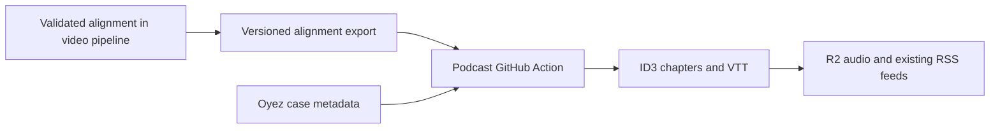

# Podcast integration

The shared transcript handoff runs as soon as alignment completes, independently of photo/card review. It reuses `/podcast/alignment/index.json` and versioned JSON files for the podcast, web player and future statistics consumer. Word timings remain private cloud artifacts. Artwork is attached to the index later, without duplicating or rewriting transcript JSON. Plans produce a 1500×1500 JPEG from the approved square design: current Court bench, Court seal, case name and approved advocate crops, with a two-by-two grid for four advocates. The fixed bench includes the approved real robe extensions and Jackson’s synthetic extension. YouTube thumbnails and video presentation are unchanged.

Artwork is published at an immutable, hash-named URL on the webhost and referenced by each RSS item’s `itunes:image`. It is not embedded in MP3s. Alignment has its own revision, so artwork-only updates do not download, retag or upload audio. The existing repository dispatch event name is retained for compatibility. Previously exported alignments remain available; old completed plans without artwork still publish transcripts. They need replanning only to produce new artwork.

The bench asset represents the current nine-member Court. Other Court compositions need a matching artwork template before being planned with podcast artwork enabled. The cloud verifies the Court identifiers rather than silently showing the wrong justices.

Status: implemented and enabled October 13, 2026. GitHub dry-run checks passed on Johnson, Anderson and Suncor; the first live dispatch published their chapters and VTTs to both existing feeds. Official audio stays unchanged except for ID3 tags, episode identities remain stable, and Oyez metadata remains independent. Source commit: f3b3dffc8eab34038b598c7e3ff6b76a283143a5.

## Existing flow

`scotus-podcast/podcast.py` runs Court discovery, Oyez enrichment, then generates the ordinary and Spotify feeds. `.github/workflows/build_podcast.yaml` runs hourly at minute 8 during its configured UTC weekday hours, on pushes to master, and on manual dispatch. It installs Python/Node/SoX, uses the existing R2/FTP/SMTP secrets, and commits episode state and both RSS files.

Court discovery publishes plain argument audio immediately. Oyez later supplies its own recording and transcript. `get_oyez.py:build_oyez_mp3` derives chapters from sections and justice turns, writes ID3 chapters with `add_id3v2.js`, and produces a WebVTT transcript. `upload_podcast.py` puts media on R2, publishes both feeds through FTP, and adds textual chapter timestamps for Spotify. Episode GUIDs are stable by term and docket.

The current `source` field combines audio, timing and description provenance. Once a case becomes `oyez`, its processing is largely skipped until the description format version changes. This cannot represent official audio with our alignment and an Oyez description independently.

## Recommended data flow

Export after a successful plan, when advocate portraits and cards have been approved. The plan generates square episode artwork alongside the unchanged YouTube thumbnail. Export original-audio alignment data and the artwork together, then dispatch the existing podcast Action; rendering, video upload and publication need not finish. Plain audio discovery remains independent and can publish earlier.

Move the nonvisual speaker/section consistency checks used by video planning into the preparation/export path. In particular, an appearance whose speaking turn was missed by parsing must not produce incorrectly attributed chapters while waiting for a later video-planning check. These checks require neither images nor rendering.

Publish small, immutable JSON exports and an atomically updated index under a proposed `https://scotusstats.com/podcast/alignment/` path. These contain public Court transcript/timing data only. Keep dashboard state, repair logs, credentials, unapproved images and editorial suggestions private. This lets the existing Action read exports without gaining access to the private media bucket or adding Google credentials.

For each recording, include:

- Schema version, recording ID, term, docket, argument date and case name.
- Alignment revision/hash and completion time; source PDF URL and source-audio URL, original file SHA-256 and duration.
- Speaker IDs, names, last names, roles and explicit justice/advocate kinds.
- Sections, turns and paragraph timings/text, in the original audio timebase.

The existing `scotus_cloud.presentation_data.presentation_audio` adapter already produces most of the section/turn structure the podcast consumes. Use that structure for compatibility, but account for its HTML escaping when generating plain text or VTT. Export neither video intro offsets nor video frame timings. The original audio is the timing reference.

Prefer public exports on the webhost for the first implementation. If these exports should remain private, the alternative is GitHub OIDC with read access restricted to an export prefix; it requires more setup. The existing media bucket should remain private in either design.

## Podcast changes

1. Add an alignment importer between Court discovery and Oyez enrichment. Also check exports for an episode not yet seen in the Court listing, so the next hourly scan is not a prerequisite for publishing it.
2. Separate `audio_source`, `alignment_source`, `alignment_revision`, `description_source` and `description_version`. Keep existing records compatible while migrating them.
3. Select chapter timing in this order: our validated alignment, Oyez alignment, no chapters yet. Later Oyez availability must not overwrite our timing. A newer validated revision of our alignment may replace the previous revision.
4. Extract the current chapter-building rules into a source-independent function. Preserve advocate sections, justice chapter labels, short-interjection/moderation filtering and Spotify timestamps. Feed it normalized Court/CTC turns rather than rewriting the chapter presentation around video interaction objects.
5. Fetch Oyez case descriptions independently of transcript availability. Update descriptions without downloading audio, rebuilding timing or downgrading our alignment. Track description content as well as the format version, so later Oyez edits can be picked up. Use the known Court argument date when Oyez lacks a usable Argued event. Initially retain the current basic Court description until Oyez facts/questions exist; importing the video's Codex-written description is an optional later choice.
6. Produce the existing ID3 and WebVTT outputs from the same selected alignment. Keep episode GUIDs and existing media URLs stable. Keep R2/FTP/SMTP secrets in the podcast Action; Cloud Run does not need them.

## Audio identity and publication

Our timestamps apply to the official audio we aligned. Oyez recordings can have different leading/trailing material, so never apply our times to an arbitrary Oyez MP3. Use the export's official source recording, or an existing canonical recording with the same source hash. Record that hash before ID3 tagging, since tags change the file's byte hash without changing its audio.

If the current Court download differs from that hash, retain the published episode and report the mismatch privately. Resolve it using a matching cached recording or a new alignment; do not silently apply the old timestamps to changed audio.

The current uploader uploads media only when `b2_url` is absent. Replace that condition with explicit media and alignment revisions, so a previously published episode can receive chapters or a repaired alignment. Metadata-only Oyez updates should leave media alone. Recalculate `mp3_size` after ID3 writing: it is currently measured before the tag write. Persist `vtt_url` along with the other state updates; it is currently assigned after the corresponding state write.

Upload the newly tagged audio and VTT before publishing feed changes, then save episode state and commit it. Keep enough revision state to reconcile a failed upload or feed/commit step without adding a duplicate episode. Handle CDN caching when overwriting an existing MP3/VTT URL. Already downloaded files in podcast apps may retain old chapters; feed updates cannot guarantee a client will redownload them.

Oyez attribution should describe the content actually used: an Oyez description still deserves credit even when timing comes from us. Remove outdated public promises that chapters must wait for Oyez when the integration is implemented. Add no defensive or AI disclaimers; report uncertainties privately.

## GitHub Actions changes

Keep the existing hourly schedule and manual trigger as reconciliation/fallback. Add `repository_dispatch` with an event such as `scotus_alignment_ready`, emitted after an export is published. Dispatch only the recording ID and revision; the consumer reads its configured export index. Reuse the existing GitHub App if it is installed for `DominikPeters/scotus-podcast` and permitted there. Its current video integration is scoped to the video repository, so verify and extend that target explicitly.

Use one workflow concurrency group with `cancel-in-progress: false`, explicit `contents: write` for saving episode state, and checkout of the latest master branch before publishing. A run should reconcile the whole export index, even if triggered for one case; this also covers coalesced/missed events. The existing GITHUB_TOKEN-based commits do not recursively trigger push workflows.

Extend the commit-message shortener for our alignment updates; its current patterns recognize only Court additions and Oyez events. Notifications should also distinguish chapter availability from an Oyez description update, rather than attributing our transcript to Oyez. These are changes to the existing podcast publishing path, not a separate publisher.

GitHub supports external [repository dispatch events](https://docs.github.com/en/rest/repos/repos#create-a-repository-dispatch-event) using a GitHub App installation token with Contents write permission. See [workflow concurrency](https://docs.github.com/en/actions/how-tos/write-workflows/choose-when-workflows-run/control-workflow-concurrency) and [GITHUB_TOKEN trigger behavior](https://docs.github.com/en/actions/how-tos/write-workflows/choose-when-workflows-run/trigger-a-workflow).

## Implementation order and validation

First implement a read-only importer and compare generated chapters/VTT for Johnson, Anderson and Suncor against the current rules. Check boundaries against the same source audio; preserve names and section/rebuttal behavior. Include cases where Oyez is absent, metadata arrives first, a validated alignment replaces Oyez, a new alignment revision is published, and a description update occurs without any media change.

Next add versioned exports and consume them from the hourly Action. Only then add the immediate dispatch trigger, keeping the hourly fallback. Verify both RSS variants, stable GUIDs, correct enclosure byte lengths and a repeated run that performs no unnecessary upload or commit.

One decision remains for future cases with multiple hearings or reargument: the export should distinguish recordings by date/recording ID, while the current feed stores one episode per term/docket. Preserve the current episode model initially; choose how to combine or separate multiple recordings before importing such a case, rather than silently replacing one argument with another.

## Public video links (implemented)

After a successful dashboard YouTube publication, `podcast_youtube_link` merges the recording into the private `podcast-youtube-index.json` registry and atomically exports `/podcast/youtube/index.json`. Unlisted uploads do not enter this index. An existing public link remains available while a replacement video is being reviewed.

The podcast build reads this small index after its other providers, matches term, docket and argument date, and saves `youtube_url` on matching episodes. Both feed descriptions add a YouTube link in the existing information links paragraph. This does not change episode GUIDs, audio tags or enclosures. New links appear on the next podcast workflow run; a YouTube publication does not itself launch a podcast build. The initial backfill includes 263 matches verified against public YouTube video metadata. Videos published outside the dashboard require an index refresh.

## Shared player consumer

`player-data.js` adapts the shared sections/turns to the existing `player.js` renderer. The player verifies the transcript checksum and recording identity, uses the official audio URL, and can run without Oyez case metadata. Oyez remains the transcript fallback where no shared alignment exists. Explicit recording IDs never silently fall back to a different hearing. `scotusstats/website/src/web/index.html` merges the same index into its historical search catalog, so new arguments need no catalog rebuild.

The PHP dispatcher operations are `transcript_export` after alignment and `podcast_artwork` after planning. The legacy `podcast_export` operation remains supported during rollout. Shared exports currently use the existing `podcast_enabled` controller setting.
