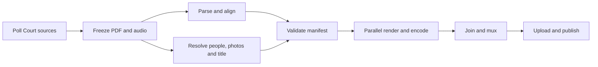

# Cloud automation proposal

Prepared 11 October 2026 from the current local checkout, saved alignment outputs, the scotusstats docket code, and current official provider documentation. This is a design and pricing review. Coordinate-based PDF extraction has since been implemented as the self-aligned workflow's default; cloud configuration has not been changed. See the [workflow instructions](/Users/dominik/GitHub/scotus-videos/self-aligned/README.md) and [validation record](/Users/dominik/GitHub/scotus-videos/docs/research/transcript-extraction-validation.json).

Updated after testing PDF extraction, reading 332 channel titles with the refreshed YouTube credential, examining the Court's docket JSON and advance hearing list, and completing an advocate-photo proof of concept. Detailed results are in [automation-followup.md](/Users/dominik/GitHub/scotus-videos/docs/automation-followup.md). The initial design uses one processing policy for all cases and Codex CLI with subscription authentication for research.

My recommendation is **Google Cloud Scheduler + a small Cloud Run discovery service + Workflows + parallel Cloud Run Jobs**, with Cloud Storage, Firestore, Artifact Registry and Secret Manager. Start with regular jobs and measure the bill. Move routine rendering to **Google Cloud Batch on Spot VMs** if the savings justify another execution backend. Keep the same containers and recording manifests for both.

At this project's likely intermittent volume, avoiding idle servers and keeping the implementation maintainable matter more than a small difference in hourly compute prices. Hetzner has attractive raw VM prices, but requires managing capacity, worker lifetimes and recovery. GitHub Actions is already integrated, but its free runner pricing should not be treated as a guarantee that an ongoing video production service is an allowed workload.

**How the current pieces connect**

| Piece | Current behavior | Consequence for automation |
| --- | --- | --- |
| [preprocess.py](/Users/dominik/GitHub/scotus-videos/preprocess.py:12) | Downloads Oyez metadata, transcripts, audio and justice images; requires advocate JPGs; derives interactions, chapters and upload text. Supports multiple arguments and opinion announcements. | Useful output contract, but downloads, enrichment and display preparation need separate stages. |
| [scotus-tool.py](/Users/dominik/GitHub/scotus-videos/self-aligned/scotus-tool.py:53) | Discovers recent cases, downloads PDF/audio, extracts through native coordinates with an optional Acrobat fallback, starts Gentle.app, asks about speakers, and generates a per-case Python script. | PDF extraction is now headless and portable; alignment startup and speaker prompts still need headless replacements. |
| [scotus-parser.py](/Users/dominik/GitHub/scotus-videos/self-aligned/scotus-parser.py:120) | Extracts speaker turns, paragraphs and sections; creates flattened alignment text. Coordinate exports use printed paragraphs, while saved Adobe text retains legacy parsing. | Native extraction preserves punctuation, paragraph indents and page continuations, with source-line offsets in its sidecar. |
| [self-aligned-preprocess.py](/Users/dominik/GitHub/scotus-videos/self-aligned-preprocess.py:12) | Consumes the aligned transcript and local MP3, while still expecting Oyez-shaped case metadata, justice membership, dates, facts and links. | Self-alignment currently removes the Oyez transcript dependency, not all Oyez dependencies. A compatibility adapter can avoid rewriting the UI immediately. |
| [screenshot.js](/Users/dominik/GitHub/scotus-videos/screenshot.js:33) and [script.js](/Users/dominik/GitHub/scotus-videos/script.js:505) | One Chromium page advances through sections and paragraphs, mutates scroll position, captures changing states and writes image durations. Landscape output is 3840 × 2160. | Independent workers need complete starting state; splitting the screenshot loop alone is insufficient. |
| [build-video.py](/Users/dominik/GitHub/scotus-videos/build-video.py:23) | Concatenates argument/opinion audio and uses FFmpeg to turn changing images into a 20 fps H.264 MP4. | Encode video chunks concurrently, join them without another video encode, and mux continuous audio once. |
| [upload-video.py](/Users/dominik/GitHub/scotus-videos/upload-video.py:55) | Uploads unlisted, then sets thumbnail, playlist and timestamp comment. | Add durable upload state and an explicit publication stage. A successful upload followed by a failed comment must not cause a duplicate upload. |
| [videobuild.yml](/Users/dominik/GitHub/scotus-videos/.github/workflows/videobuild.yml:1) | Already builds and uploads on Ubuntu after the repository owner opens/reopens an issue containing an Oyez URL. | Existing cloud experience and CI plumbing; current trigger is manual and tied to Oyez. |
| [artifacts pipeline](/Users/dominik/GitHub/scotus-videos/artifacts/pipeline.py:70) and [renderer](/Users/dominik/GitHub/scotus-videos/artifacts/render.js:97) | Already provide docket download, structured model output, request caching, evidence validation and timestamp-based rendering. | Reuse these patterns. Its current exporter is sequential, uses 1080p and a different display, and needs extension before replacing the channel renderer. |

The docket fetch/cache pattern in [count_amicus_briefs.py](/Users/dominik/GitHub/scotusstats/data-pipeline/count_amicus_briefs.py:70) is useful. Extract reusable functions instead of importing that script: its module-level code processes and writes another project's dataset. Prefer the Court's [docket JSON endpoint](https://www.supremecourt.gov/RSS/Cases/JSON/25-332.json) for proceedings and attorney details, with HTML as a fallback. Its attorney arrays provide full names, firms/agencies and addresses; counsel of record can differ from arguing counsel. Use the monthly hearing list to identify expected speakers before the argument and the transcript appearances to confirm them afterward.

**Issues to resolve before unattended runs**

- Replace `case_number.txt`, `comment.txt`, fixed localhost ports and shared output directories with explicit arguments and a workspace per recording. Concurrent cases and retries otherwise collide.
- The local screenshot code currently skips new images numbered 0–980 through a hard-coded resume condition. Replace it with validation against a manifest and renderer version.
- Replace per-case generated `line-up.py` with a normal alignment adapter plus speaker JSON. Bound its searches for a subsequent timed word, handle untimed trailing words, and populate section/turn stop times. The generated format omits section stops, while `self-aligned-preprocess.py` reads them.
- The appearances parser misses ordinary unprefixed entries. Running it against saved Trump v. Cook text returned only Sauer, omitted Clement, and produced the role `for the the`. This is a concrete place where structured extraction from the appearances page can help.
- The advocate cache is keyed by surname and keeps a case-specific role on the person record. Resolve identity using full name plus evidence, and derive the role independently for each argument.
- Raise errors on failed encoding and preserve completed stages. Current `os.system` calls do not provide a reliable workflow failure contract.
- Split the upload script's broad exception handler into upload and post-upload stages. Its B2 import is commented out, so the fallback also references undefined names. Persist the YouTube ID immediately after successful creation.
- Remove the local OAuth insecure-transport setting from cloud execution. Put the existing channel's OAuth grant in Secret Manager instead of downloading credentials through a secret URL. The research/rendering stages need no channel credentials.
- Update descriptions and acknowledgements to distinguish official Court transcripts from any Oyez material still reused. Generated summaries should be identified as such.

**Proposed recording workflow**

1. **Discover and prepare.** Poll the term's transcript and audio indexes, with the homepage as another discovery source. Follow actual links; do not assume every audio filename equals the docket number. The Court says both [transcripts](https://www.supremecourt.gov/oral_arguments/argument_transcript.aspx) and [audio](https://www.supremecourt.gov/oral_arguments/argument_audio.aspx) are posted on argument day. Transcripts can subsequently be revised. Poll approximately every five minutes on argument days, and reconcile recent days less frequently afterward. Use `America/New_York` for argument-day windows. Ahead of argument day, follow the [calendar and hearing-list indexes](https://www.supremecourt.gov/oral_arguments/calendarsandlists.aspx): the hearing list names the scheduled arguing advocates, including amici. Join those names to docket JSON for firm/city evidence and prefetch portraits. Refresh amended lists and day calls; the final appearances page confirms actual speakers.

2. **Freeze inputs and claim work.** Use a recording identity containing term, docket(s), argument date and recording identifier. Docket alone cannot distinguish rearguments or multiple recordings. Record source URLs, download times and SHA-256 hashes. Verify PDF bytes and audio decodability, not just HTTP 200. Firestore transactions should claim a recording with an expiring lease. Configure a start date/backfill policy so initial deployment does not unexpectedly publish the archive. Track corrected PDFs as a new source revision; a correction after publication needs a separate replacement policy because YouTube cannot replace the media of an existing video.

3. **Extract and align.** The default [native extractor](/Users/dominik/GitHub/scotus-videos/self-aligned/scotus_pdf.py) now detects the line-number gutter and its vertical extent, reconstructs visual rows and records printed paragraph indents. It preserves front matter without the prototype's fixed crop. The twelve comparable cases still differ from saved Adobe text by only 36 normalized word-token edits across 260,142 tokens; this measures agreement, not extraction accuracy. Paragraph and punctuation validation is recorded separately. Keep display text and source offsets distinct from alignment normalization. Adobe PDF Extract API is a possible headless fallback, but has not been tested against Acrobat's desktop export. The [completed Cloud Run benchmark](/Users/dominik/GitHub/scotus-videos/docs/research/alignment-decision.md) and [archived full-argument validation](/Users/dominik/GitHub/scotus-videos/docs/research/alignment-decision.md) support English CTC on CPU, using word-level wildcards. The 80-minute fixture mapped all 529 paragraphs and 372 speaker starts, with median paragraph agreement of 70 ms and a 95th percentile of 510 ms against usable Gentle references. Fine alignment is validated at this scale; the compatibility adapter still needs independent coarse window discovery, numeric handling and overlap reconciliation. Keep Gentle outputs as comparison fixtures. Long recordings need reliable audio/reference-text boundaries before parallel alignment. See the [follow-up comparison](/Users/dominik/GitHub/scotus-videos/docs/automation-followup.md) for methods, limitations and sources. Fetch Court media and pinned model weights directly inside the cloud; only small configuration/results should cross the operator's metered connection.

4. **Resolve metadata alongside alignment.** Build case metadata from the official caption, argument index/date, appearances, docket and question-presented document. Import existing justice portraits and advocate IDs into a persistent registry. Preserve Oyez identifiers as aliases where known, and allocate stable local IDs for new people. Keep the historical court roster and argument-specific absences/recusals explicit. An Oyez-shaped adapter can feed the current display while Oyez becomes an optional source of supplementary metadata.

5. **Validate and plan.** Require known speakers, consistent section/turn/block intervals, timestamps within the audio, preserved transcript text, loaded assets and complete metadata. Every stage writes a receipt containing its input hashes, code/container version and output hashes. Completed work can then be reused on retries. Source extraction, model research, alignment and rendering should have separate status and error fields.

6. **Render and assemble.** Create one immutable display plan and distribute its chunks. Retry failed chunks only. Verify checksums, frame counts and durations before assembly. Join video-only chunks and mux audio once. Produce the thumbnail from the same frozen metadata/assets.

7. **Upload, finish and publish.** Run a separate uploader with the channel's OAuth grant. Use [resumable upload sessions](https://developers.google.com/youtube/v3/guides/using_resumable_upload_protocol), persist the session URL, and reconcile an interrupted upload before starting another. Store the video ID before thumbnail, playlist or comment calls. Make those steps individually retryable. Preserve the present unlisted behavior during rollout; the eventual autonomous policy can publish after required checks and processing succeed. Upload completion and availability of processed 4K video are separate milestones. Notify on completion, permanent failure or an unresolved exception, rather than on every poll.

**Autonomous photos and titles**

Use bounded Codex CLI tasks with schema-validated results, live web search and subscription authentication. The artifacts pipeline already demonstrates useful patterns for structured output, caching and evidence checks, although its Responses API transport would need a Codex CLI adapter. Choose among the models available to the signed-in account after evaluating known examples; the successful portrait proof of concept establishes feasibility, not a general success rate.

For each new advocate, supply the hearing-list entry, then the exact appearances entry when available, and matching docket counsel details: full name, firm/agency, city and side. Counsel of record and arguing counsel can differ, so the appearances page determines who actually speaks. Search the named employer first, then wider professional profiles or articles. The [photo proof of concept](/Users/dominik/GitHub/scotus-videos/docs/research/advocate-photo-poc/README.md) found Anthony J. Dick before his October 13 argument, cross-checked his identity against the docket and employer, and downloaded an accessible professional portrait. Kevin Joel Page's bounded search found placeholders and namesakes, supporting the need for a fallback.

Require textual identity evidence from the source page and its association with the image. Vision can judge whether a candidate is a usable portrait and suggest a crop; a familiar-looking face is not identity evidence. Download the original image through application code, verify it decodes, normalize the crop, and save the source page, image URL, retrieval date and identity evidence. Store an asset-to-video mapping so a later replacement or takedown request identifies affected videos. Cache the result permanently and allow targeted refreshes.

Give photo research a small search/time budget. If sources are inaccessible, require login, or remain ambiguous, use the employer's logo or a neutral initials card automatically. Missing photos should not hold up a sound transcript. Unknown speaker identity or contradictory metadata is a different error and should be surfaced rather than silently assigned to someone.

For titles, return a plain-English topic, full title, neutral summary and supporting source references. Use the question presented and transcript, with the docket to establish posture. Preserve the channel's observed format: `Oral Argument on {topic}: {short case name}`. Examples include `Oral Argument on birthright citizenship: Trump v. Barbara` and `Oral Argument on firing a Federal Reserve governor: Trump v. Cook`. Topic length varies; among matching titles the median was five words, so do not enforce the initially suggested 1–3-word cap. Validate YouTube's title length in code. Keep disputed assertions attributed and distinguish questions raised at argument from decided holdings. LLM cleanup should not rewrite the displayed official transcript or invent timestamps.

[Headless Codex](https://learn.chatgpt.com/docs/non-interactive-mode) supports structured output and saved authentication. Run enrichment in a separate trusted private worker; deterministic application code retains control of job state and publication. OpenAI's [account-auth automation guide](https://learn.chatgpt.com/docs/auth/ci-cd-auth) requires persisting refreshed authentication and serializing jobs sharing an auth copy, and excludes public-repository workflows. This repository is public, so keep that worker's deployment/configuration private and pass it Court data rather than executing the public checkout with account credentials. The proposed Cloud Run authentication handling is detailed in the follow-up; it remains to be tested there.

**Parallel rendering design**

The existing event-based capture is already valuable. A saved Trump v. Cook transcript has 753 blocks across 444 turns over about 118 minutes. At 20 fps, two hours of output contains 144,000 encoded frames, but Chromium needs to capture only distinct text/scroll/display states.

Make each render request reconstruct complete state from the frozen manifest: section, active text, active speaker, advocate card, interaction progress, transcript scroll position, overlays and document excerpt. Either derive that state directly or use a lightweight sequential layout-planning pass to record absolute scroll positions. Replaying all preceding screenshot work in every worker would squander parallelism. The [artifact player's timestamp renderer](/Users/dominik/GitHub/scotus-videos/artifacts/player.js:48) proves the useful seeking pattern, but it does not yet reproduce the original layout and scroll animation.

Partition into roughly 5–10-minute chunks, preferably at display-event boundaries, and balance by expected screenshot/animation work. Begin with 4–8 concurrent workers, measuring one or two Chromium pages per worker and reserving CPU for encoding. Have each worker capture changing images, encode a video-only chunk locally, and upload only the chunk plus its receipt. Keep large PNG collections out of remote storage. Use temporary disk where available; [Cloud Run Jobs now supports ephemeral disks](https://docs.cloud.google.com/run/docs/configuring/jobs/ephemeral-disk), with quotas to configure for the planned parallelism.

Quantize the complete timeline once to integer 20 fps frame indices. Define chunks as non-overlapping frame ranges and require exact frame counts. Pin Chromium, fonts, FFmpeg and encoder settings; every encoded chunk must begin independently and have matching stream parameters. Concatenate without re-encoding, then encode/mux continuous audio once to avoid audio padding at chunk seams. Model splash screens, silence between recordings and outros explicitly so chapter/comment timestamps derive from the same video clock.

Preserve 4K as the initial landscape baseline. The artifacts exporter currently uses 1080p, so adopting it unchanged would alter output quality. Benchmark 1080p only as an optional speed/cost choice. Chromium and libx264 rendering can remain CPU jobs while a modern aligner uses a separate GPU job. Consider hardware video encoding only after measuring its quality and total runtime benefit.

**Provider and cost comparison**

Prices below are a snapshot, excluding taxes, network, storage, logs, disk, image builds and AI calls unless stated. The comparable unit is a 4-vCPU/8-GiB worker; equal vCPU counts do not imply equal performance. Google Spot values were read from the live rendered official pricing page because indexed search results showed substantially older rates.

| Option | Published/current compute price | Assessment |
| --- | --- | --- |
| [Google Batch + c3d-highcpu-4 Spot, Iowa](https://cloud.google.com/spot-vms/pricing?hl=en) | $0.0382/hour; 8-vCPU/16-GiB variant $0.0764/hour | Strong candidate for inexpensive managed batch work; checkpoint/retry and capacity fallback are essential. [Batch has no extra service charge](https://cloud.google.com/batch/pricing). |
| [Google Cloud Run Jobs, Iowa](https://cloud.google.com/run/pricing) | $0.3168/hour before free allowance | Easiest managed starting point. Monthly allowance is 240,000 vCPU-seconds and 450,000 GiB-seconds, shared at billing-account level. |
| [AWS Batch + EC2 Spot](https://aws.amazon.com/batch/pricing/) | Depends on instance, region and availability zone | Close alternative. Benchmark live c6a/c7a/c6i/c7i prices and completion times; current research does not establish an AWS-versus-Google winner. |
| [AWS Fargate Linux x86, N. Virginia](https://aws.amazon.com/fargate/pricing/) | Approximately $0.19748/hour | Simple managed container option; compare Fargate Spot separately. Not the cheapest quoted paid compute here. |
| [Hetzner CX33, Germany/Finland](https://docs.hetzner.com/general/infrastructure-and-availability/price-adjustment/) | €0.0136/hour, capped at €8.49/month, excluding IPv4/VAT | Lowest quoted raw VM rate here; shared 4-vCPU/8-GB resources. Budget-plan availability is a constraint. |
| [Hetzner CPX32, Germany/Finland](https://docs.hetzner.com/general/infrastructure-and-availability/price-adjustment/) | €0.0569/hour, capped at €35.49/month, excluding IPv4/VAT | Another shared 4-vCPU/8-GB worker; a substantially different price from CX. Neither server is free merely because it is powered off: delete ephemeral workers. |
| [GitHub standard public runners](https://docs.github.com/en/billing/concepts/product-billing/github-actions) | $0 compute; artifact storage still matters | This repository is public and already has a workflow. [Usage terms](https://docs.github.com/en/site-policy/github-terms/github-terms-for-additional-products-and-features#actions) constrain hosted runners to software workflows; I would not budget a permanent production rendering service on assumed free eligibility. |

For illustration, suppose ten videos collectively use **40 worker-hours/month** at 4 vCPUs/8 GiB, including alignment, rendering and assembly. This is a budget scenario, not measured runtime:

- Google Spot compute: **$1.53** before retries and other resources.
- Cloud Run compute: **$12.67** before allowances, or about **$7.45** if the stated monthly free allowance is otherwise unused.
- Fargate x86 compute: **$7.90** before other resources.
- Ephemeral Hetzner CX33 compute: **€0.54**, plus the controller and other costs. Keeping that worker permanently allocated costs the monthly cap instead.

Eight identical workers running for 15 minutes consume two worker-hours, not eight. Parallelism can reduce elapsed time at similar compute cost when work scales; image startup, duplicated inputs, idle CPU and retries increase the total.

Use one Scheduler job calling a small discovery service, rather than starting a large processing container on every empty poll. [Scheduler](https://cloud.google.com/scheduler/pricing?hl=en) includes three jobs per billing account, then charges $0.10/job/month. Keep storage and workers in one region. Avoid accidentally provisioning permanent network infrastructure: an AWS [NAT gateway example](https://aws.amazon.com/vpc/pricing/) is $0.045/hour, approximately $33/month even before traffic.

Keep inputs, metadata, speaker assets and completed MP4s according to a retention policy; discard successful scratch frames and short-lived chunks. Google regional Standard storage in Iowa is approximately [ $0.02/GiB/month](https://cloud.google.com/storage/pricing). Existing [Backblaze B2](https://www.backblaze.com/cloud-storage/pricing) is also suitable for archives: the current published rate starts at $6.95/TB/month, with 10 GB free and free egress up to three times average storage. Use same-region storage for active Google processing; account separately for upload/export traffic and cross-provider copies.

Codex research will use the existing ChatGPT subscription's included allowance, subject to its [usage limits](https://learn.chatgpt.com/docs/pricing). That avoids separate API inference charges within the allowance; it still consumes account usage and cloud worker time. Queue work when limits are reached and retain cached portraits/metadata. Do not silently switch to API billing or purchase credits.

An optional L4 alignment job at 4 vCPUs/16 GiB is approximately **$1.0465/hour** at current Iowa [Cloud Run rates](https://cloud.google.com/run/pricing), including CPU and memory before allowances. Five allocated minutes cost approximately **$0.0872**. These are runtime scenarios, not measurements of how quickly an aligner processes a full argument. Model loading and other startup time count toward the cost. [GPU Jobs](https://docs.cloud.google.com/run/docs/configuring/jobs/gpu) require non-zonal-redundant configuration and available quota.

The measured exploratory GPU execution loaded three models and ran twelve short clip passes in **141.53 allocated seconds**, approximately **$0.041** in compute before allowances. The combined experiment, including the [Gentle CPU comparison](/Users/dominik/GitHub/scotus-videos/docs/research/alignment-decision.md) and two full-argument CPU validations, is estimated at **$0.60–$0.66** before free allowances, including builds, initial failed downloads, transfers and storage/operations; temporary resources were removed and verified. Gentle processed the short sample in 64.18 seconds on two CPUs and 58.13 seconds on four, versus English CTC's 30.77 seconds on four. Automatic L4 quota was granted in Northern Virginia and Belgium, while Iowa refused it for this project. The GPU benchmark ran in Northern Virginia. Co-locate the production image registry, cache and jobs to avoid the experiment's $0.110 of region transfer charges. The subsequent word-level English CPU validation processed its full-case windows in 7.72 minutes, with 2.07 GiB peak process RSS; its whole execution including extra clips lasted 10.98 minutes, about $0.058 in CPU/RAM lifecycle charges. Five of 425 comparable paragraph starts differed from Gentle by more than a second. Gentle agreement is not independent accuracy evidence, and coarse window discovery was supplied by existing fixtures.

Cloud Run's newer [delayed jobs](https://docs.cloud.google.com/run/docs/delayed-jobs) offer lower compute rates, but are currently a preview and provisioning can wait up to 12 hours. They are an optional archive/backfill choice; start with regular jobs for every new argument.

**Latency choices and rollout**

Use one queue and regular Cloud Run Jobs for every case initially, with approximately five-minute polling on argument days and prepared advocate assets. Measure discovery, extraction, alignment, enrichment, rendering, encoding, upload and YouTube processing separately before setting an elapsed-time target. The principal latency choices are polling frequency, worker concurrency, prepared assets and whether publication waits for processed 4K. If Spot is adopted later, bound capacity waiting and retries under the same recording lease.

Saved Gentle outputs provide a useful starting baseline: across 11 full alignments, approximately 3.9–6.0% of words lacked timestamps. The longest consecutive untimed runs ranged from 8 to 71 words. These figures are not an accuracy measurement and should not become an automatic pass threshold by themselves. Check local gaps, paragraph anchors, start/end coverage and extracted-text fidelity. Retry or flag anomalous spans instead of assigning every untimed paragraph to an arbitrarily distant next timestamp.

Implement in this order:

1. Build the recording manifest and compatibility adapter around the implemented native PDF extractor and parser CLI. Make alignment and speaker resolution noninteractive; use the validated English CPU configuration and archived full-case fixtures to test independent coarse matching, numeric normalization, overlap reconciliation and the remaining difficult caption boundaries.
2. Implement complete-state rendering and chunk encoding. Compare single-worker and parallel output at text/scroll/section boundaries; verify exact frame counts and continuous audio.
3. Run the containers through Cloud Run Jobs using historical inputs and unlisted upload behavior. Add durable upload/session state and independent post-upload retries.
4. Add discovery, leases, scheduling, hearing-list prefetching and the private Codex CLI enrichment worker. Verify headless authentication persistence, structured results and exceptional-case handling against known advocates and transcripts.
5. Enable autonomous publication under the configured checks. Consider Batch Spot only after measured usage warrants it.

The useful benchmark is three complete cases: an ordinary argument, a long argument, and one with difficult speaker identification or multiple recordings. Record wall time, peak memory, scratch bytes, screenshot count, output size, model usage and cost per successful upload. Compare 2/4/8-vCPU configurations and 4/8 concurrent chunks. This determines the true cheapest provider/configuration; hourly list prices alone cannot.
